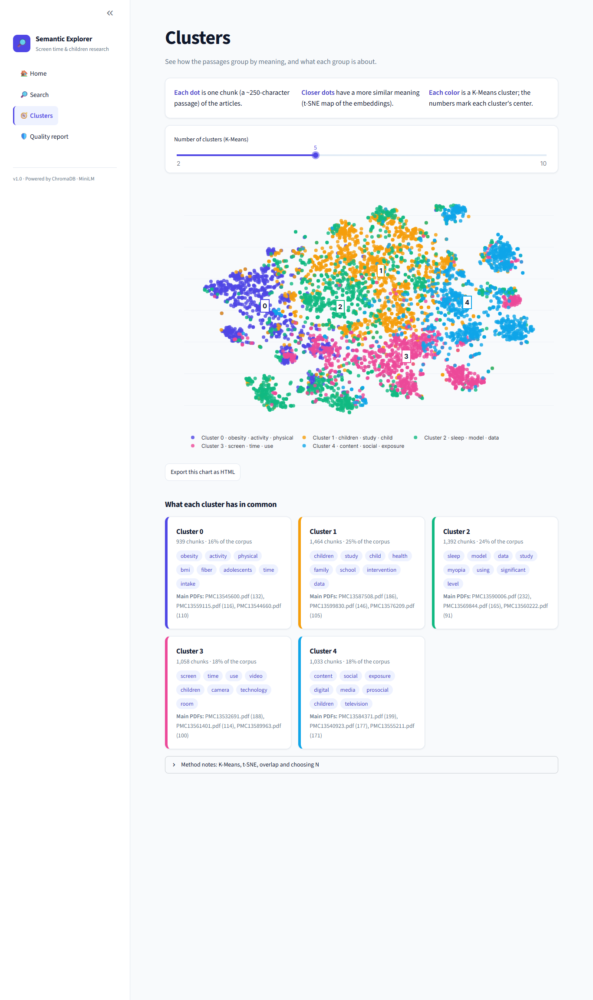
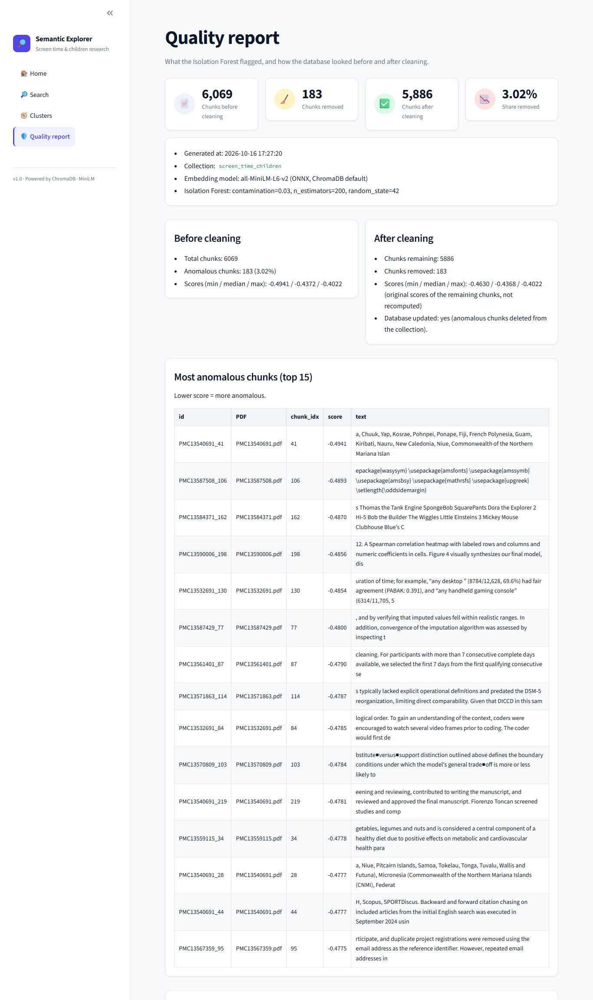

# Capstone Data Science

[🇧🇷 Português](README.md) · 🇺🇸 English

## Semantic Search, Quality Control and Cluster Exploration over Scientific Articles

## What is this project?

An end-to-end system that turns scientific articles (PDF) into an **interactive application** to explore a document corpus using embeddings and clustering.

1. Documents are loaded and split into chunks.
2. Each chunk becomes an **embedding** (a numeric representation of its meaning) stored in a vector database.
3. You can **search by meaning**, not by exact keywords.
4. An **Isolation Forest** flags anomalous chunks; the system writes a **quality report** (before and after cleaning) and removes them from the database.
5. A **web interface** (Streamlit) offers search, an interactive **K-Means / t-SNE cluster map** and the quality report.

**Example:** searching for "effects of screen time on children" also finds passages about "impact of digital media on minors", even when they do not share the same words.

Technical reports (architecture diagrams, decisions, results and future work) are available in [Portuguese](docs/relatorio_projeto.md) and [English](docs/project_report.md).

## Chosen domain

**Effects of screen use on children and adolescents**

Topics covered by the articles:

- Screen time and mental health
- Digital media and childhood obesity
- Impact on sleep and sleep quality
- Cognitive development and learning
- Behavior and socialization
- Interventions and clinical recommendations

**Data source:** 30 open-access scientific articles from **PubMed Central (PMC)**, collected in 2026. PDF file names are their PMC identifiers (e.g. `PMC13589963.pdf`).

## Pipeline (data flow)

```
PDFs / .txt (data/raw/)
    |
    v
[loader.py]   Text extraction + chunking (250 characters, 50 overlap)
    |
    v
chunks.jsonl (data/processed/)   6,165 chunks
    |
    v
[clean.py]    Removes empty, too-short, mostly-numeric or garbled chunks (rules, no ML)
    |
    v
chunks.jsonl (cleaned)           6,069 chunks
    |
    v
[embedder.py] Embeddings (all-MiniLM-L6-v2, ONNX) + ChromaDB indexing
    |
    v
ChromaDB (data/chroma/)          Persistent vector database, 6,069 chunks
    |
    +--> [search.py]       Semantic search (terminal and interface)
    |
    +--> [run_quality.py]  Isolation Forest -> reports/quality_report.md
    |                      removes 183 anomalous chunks -> 5,886 chunks
    |
    +--> [clustering.py]   K-Means (N chosen by the user) + t-SNE map
    |
    v
[app.py]  Streamlit interface: Home | Search | Clusters | Quality report
```

Each step reads the output of the previous one, so every script can be re-run independently.

## Web interface

Run `streamlit run app.py` and open http://localhost:8501. The sidebar switches between four pages:

| Page | What it does |
|---|---|
| **Home** | Landing page: number of indexed chunks, source documents and chunks removed by the quality check; shortcuts to the other pages; six research topics that open the search with a ready question. |
| **Search** | Type a question and get the 5 most similar chunks (1 to 10 with the slider). Each result shows the source PDF, chunk number, cosine **distance**, **similarity** (1 − distance) and the text. |
| **Clusters** | Choose the number of clusters N (2 to 10). The chunks are regrouped with **K-Means** and drawn on an interactive **t-SNE** map. Hovering a point shows PDF, chunk number and a text snippet. Below the map, each cluster shows its size, characteristic terms (TF-IDF) and main PDFs. A button exports the current chart as HTML to `reports/figures/`. |
| **Quality report** | Shows `reports/quality_report.md`: what the Isolation Forest found and how the database looks before and after cleaning. |

If the index does not exist, every page shows **"Index not found. Run the pipeline first"** instead of failing.

### Screenshots

**Home page:**


**Search results:**


**Search with no results:**


**Clusters and quality report:**




Interactive cluster charts are also available to open in a browser:

- [View clusters with K=3](reports/figures/clusters_k3.html)
- [View clusters with K=5](reports/figures/clusters_k5.html)
- [View clusters with K=10](reports/figures/clusters_k10.html)

## Project structure

```
CAPSTONE/
├── app.py                   # Streamlit interface (entry point)
├── data/
│   ├── raw/                 # Original PDFs (30 articles)
│   ├── processed/
│   │   ├── chunks.jsonl     # Extracted and cleaned text chunks
│   │   └── tsne_coords.npy  # t-SNE cache (generated, not versioned)
│   └── chroma/              # ChromaDB vector database (generated, not versioned)
├── src/
│   ├── loader.py            # Reads PDF / .txt -> chunks.jsonl
│   ├── clean.py             # Filters chunks.jsonl (removes noise)
│   ├── embedder.py          # Generates embeddings -> ChromaDB
│   ├── search.py            # Semantic search (command line and interface)
│   ├── store.py             # Reads the corpus from / deletes ids in ChromaDB
│   ├── anomaly.py           # Isolation Forest
│   ├── quality_report.py    # Writes reports/quality_report.md
│   ├── run_quality.py       # Runs the quality check (--dry-run available)
│   ├── clustering.py        # K-Means, t-SNE and TF-IDF cluster summaries
│   ├── test_search.py       # Validates the search (in-domain vs off-domain, uses the real database)
│   ├── demo.py              # Demo with fixed domain questions
│   └── logging_config.py    # Logging configuration
├── ui/                      # Interface code (one file per page + theme and components)
├── tests/                   # Automated tests (32, no network, no real database)
├── reports/
│   ├── quality_report.md    # Generated by run_quality.py
│   ├── removed_ids.json     # Ids removed from the database (audit)
│   └── figures/             # Exported cluster charts (backup for presentations)
├── assets/topics/           # SVG illustrations of the research topics
├── docs/
│   ├── relatorio_projeto.md # Technical report (Portuguese)
│   ├── project_report.md    # Technical report (English)
│   └── screenshots/         # Interface screenshots
├── .streamlit/config.toml   # Interface theme
├── Dockerfile, docker-compose.yml, .dockerignore
├── .gitlab-ci.yml           # CI: runs the tests
├── requirements.txt         # Python dependencies
└── README-EN.md             # This file (README.md is the Portuguese version)
```

## Installation

### Prerequisites

- Python 3.10+
- Windows, macOS or Linux
- Git (optional)
- Docker (optional, to run the interface in a container)

### Step 1: Get the project

```bash
git clone <your-repository-url>
cd CAPSTONE
```

### Step 2: Create a virtual environment

```bash
python -m venv venv
```

Activate it:

- **Windows (Git Bash):** `source venv/Scripts/activate`
- **Windows (PowerShell):** `.\venv\Scripts\Activate.ps1`
- **Windows (CMD):** `venv\Scripts\activate.bat`
- **Linux / macOS:** `source venv/bin/activate`

### Step 3: Install dependencies

```bash
pip install --upgrade pip
pip install -r requirements.txt
```

Key libraries: `pypdf` (PDF reading), `chromadb` (vector database, also ships the embedding model), `scikit-learn` (Isolation Forest, K-Means, t-SNE, TF-IDF), `streamlit` and `plotly` (interface and interactive chart). There is no PyTorch: the embedding model runs on ONNX Runtime inside ChromaDB.

## How to run

### 1. Build the index (from scratch)

Run the steps **in this order**:

```bash
python src/loader.py      # Reads PDFs (and .txt files) and generates chunks
python src/clean.py       # Removes invalid chunks
python src/embedder.py    # Generates embeddings and loads ChromaDB (takes a few minutes)
```

`embedder.py` downloads the embedding model (~80 MB) on its first run and caches it for later runs. It deletes and recreates the collection, so it always starts from a clean index.

### 2. Run the quality check

```bash
python src/run_quality.py --dry-run   # only detects and writes the "before" section (nothing is removed)
python src/run_quality.py             # detects, reports, removes the anomalies and writes the "after" section
```

The second command changes the database. **Run it once per index**: running it again analyses the already-cleaned database and removes another ~3%. To start over, run `python src/embedder.py` first.

### 3. Open the interface

```bash
streamlit run app.py
```

Then open http://localhost:8501. For the Clusters page, the first run computes the t-SNE map (about a minute) and caches it in `data/processed/tsne_coords.npy`.

### 4. Search from the terminal

```bash
python src/search.py "screen time and obesity in children"
python src/search.py "does screen time affect sleep in children?"
```

### 5. Run with Docker

```bash
docker compose up --build
```

The interface is served at http://localhost:8501. The folders `data/` and `reports/` are mounted as volumes, so **`data/chroma/` must already exist** (run the pipeline first); otherwise the page shows "Index not found". On the first search the container downloads the embedding model (~80 MB), so it needs internet access that time. Stop it with `docker compose down`.

### 6. Run the tests

```bash
python -m unittest discover -s tests -t . -v
```

32 tests, about 3 seconds. They use synthetic data and an in-memory ChromaDB: no network, no model download and no real database. The same command runs in the GitLab CI (`.gitlab-ci.yml`).

### Quick validation test of the search

Compares a search **inside the domain** against one **outside the domain** (uses the real database):

```bash
python src/test_search.py
```

Result obtained on this project:

```
Query: "screen time and obesity"   -> average distance 0.17
Query: "recipe for chocolate cake" -> average distance 0.78
OK: the domain query returned smaller distances than the unrelated query.
```

If the in-domain distances are clearly smaller, the index is working.

### Demo (several domain questions)

```bash
python src/demo.py
```

Runs a fixed list of questions (two about the domain plus one off-topic control question) and prints, for each result: distance, similarity, source PDF and chunk number. Each result shows the cosine distance (lower = more relevant) and the similarity (1 − distance).

## Quality control with Isolation Forest

The quality check runs **after** the vector database is loaded, over **all embeddings at once**: a chunk is only anomalous *relative to the rest of the corpus*.

- **Isolation Forest** (`src/anomaly.py`): 200 random trees. A chunk that is isolated with few cuts gets a **low score**, meaning it is more anomalous. `contamination = 0.03` means the 3% lowest-scored chunks are flagged.
- **Report** (`reports/quality_report.md`, generated by `src/run_quality.py`, never written by hand): parameters, totals and score statistics before cleaning, the 15 most anomalous chunks, anomalies per PDF, and the database after cleaning.
- **Audit:** the removed ids are saved in `reports/removed_ids.json` before anything is deleted.

Result on this project:

| | Chunks |
|---|---|
| Before cleaning | 6,069 |
| Flagged as anomalous (3.02%) | 183 |
| After cleaning | 5,886 |

**Curation note:** not every flagged chunk is garbage. The most anomalous chunks include real noise (lists of countries, a LaTeX preamble, a list of TV characters) but also legitimate methods text. The report shows examples so the removal can be reviewed before trusting it.

## Clusters (K-Means + t-SNE)

- **K-Means** (`src/clustering.py`) groups the 384-dimensional embeddings into N groups; N is chosen in the interface (2 to 10). K-Means always returns N groups, even when the data has no natural groups, so clusters should be read as a guide.
- **t-SNE** projects the embeddings to 2D (cosine metric) only to **draw** the map; the clusters are computed on the original embeddings. The projection is slow, so it is cached on disk and recomputed only if the number of chunks changes.
- Each cluster is summarized with its **characteristic terms** (TF-IDF) and its **main PDFs**.

Example with N = 3 (5,886 chunks):

| Cluster | Chunks | Characteristic terms |
|---|---|---|
| 0 | 2,559 | study, children, data, intervention, health, family, school |
| 1 | 1,822 | screen, use, time, content, exposure, digital, television |
| 2 | 1,505 | sleep, obesity, time, activity, physical, screen, bmi |

## Understanding semantic search

### How does it work?

1. **Embeddings:** each text chunk is converted into a vector of numbers (384 dimensions for all-MiniLM-L6-v2). The vector captures the *meaning* of the text.
2. **Index:** all vectors are stored in a vector database (ChromaDB), which allows fast nearest-neighbor lookup.
3. **Search:** the question is converted into a vector with the same model. The system finds the closest vectors using cosine distance.
4. **Result:** the most similar chunks are returned with their distance: **0 means identical meaning**, values near **1 mean unrelated**, and the closer to 0 the more relevant. The interface also shows the **similarity** (1 − distance).

### Why is it better than keyword search?

| Keyword search | Semantic search |
|---|---|
| Looks for the exact words | Looks for the meaning |
| "tablet use" does not match "screen time" | "tablet use" is close to "screen time" |
| May return nothing | Returns relevant passages |

### Real example from this project

```
Query:  "is screen time associated with childhood obesity?"

Result #1: PMC13589963.pdf, chunk 0
           "The Association Between Daily Screen Time and Childhood
            Overweight and Obesity: Current Evidence and Potential Mechanisms..."
           Distance: 0.1167   Similarity: 88%

Query:  "what are the best recipes for chocolate cake?"   (off-topic control)

Result #1: distance 0.7166   Similarity: 28%
```

Chunk 0 is the first piece of the article (title and authors), which is why it matches a question that is almost identical to the title.

Short queries (for example a single word such as "depression") tend to have larger distances than full questions, even when the results are correct (best result: distance 0.4694, similarity 53%). Compare distances within the same query rather than across very different queries.

## Main dependencies

- `pypdf`: PDF text extraction
- `chromadb`: vector database, also provides the embedding function (all-MiniLM-L6-v2 running on ONNX Runtime)
- `scikit-learn`: Isolation Forest, K-Means, t-SNE and TF-IDF
- `streamlit`, `plotly`: interface and interactive chart
- `numpy`

See `requirements.txt` for the full list.

## Data origin

The 30 PDFs come from **PubMed Central**, an open-access repository of scientific articles. Each article's license allows reuse (typically CC-BY).

Examples of articles in the collection:

- `data/raw/PMC13589963.pdf`: review on daily screen time and childhood overweight and obesity
- `data/raw/PMC13570809.pdf`: artificial intelligence interaction vs. traditional screen exposure in child development
- `data/raw/PMC13589181.pdf`: types of screen time and developmental outcomes in children aged 0-6
- ... (30 in total)

To read an original article, use its PMC ID:

```
https://www.ncbi.nlm.nih.gov/pmc/articles/PMC13589963/
```

## Limitations and future work

- **Isolation Forest cut-off:** `contamination = 0.03` fixes the share of flagged chunks, whether or not there is that much noise. A manual review of the flagged chunks is recommended.
- **Supervised quality classifier (not implemented):** labeling ~20% of the flagged chunks as relevant or irrelevant and training a logistic regression to decide which ones to remove was left as future work.
- **Embedding model:** all-MiniLM-L6-v2 is small; a larger model could improve retrieval.
- **Clusters:** K-Means needs N chosen by the user and always returns N groups.
- **Index lifecycle:** `reports/removed_ids.json` is read by the interface; if the index is rebuilt with `embedder.py` without repeating the cleaning, the "removed" numbers become outdated.
- Full discussion: [`docs/relatorio_projeto.md`](docs/relatorio_projeto.md).

## Troubleshooting

### "Collection not found" or "Index not found"

**Cause:** `embedder.py` has not been run yet, so the index does not exist.

**Fix:**

```bash
python src/embedder.py
```

### Search results look wrong or random

Check, in this order:

1. `embedder.py` ran completely (the last log line shows the total chunks indexed, 6,069 here before the quality check).
2. `search.py` uses the same collection and embedding function as `embedder.py`.
3. `clean.py` did not remove too many chunks or let noise through.

### The interface still shows old numbers after running `run_quality.py`

Streamlit caches the data. Stop the app (Ctrl+C), start it again with `streamlit run app.py` and reload the page.

### Port 8501 is already in use

Stop the other `streamlit run` or `docker compose` process, or run `streamlit run app.py --server.port 8502`.

## Author

**Grazielle Nascimento Ferreira**, Capstone Data Science, 2026.

**Email:** Grazielle.Nascimento0724@jala.university

## License

This project uses data from **PubMed Central** (open access, typically CC-BY).

---

**Last updated:** October 16, 2026
