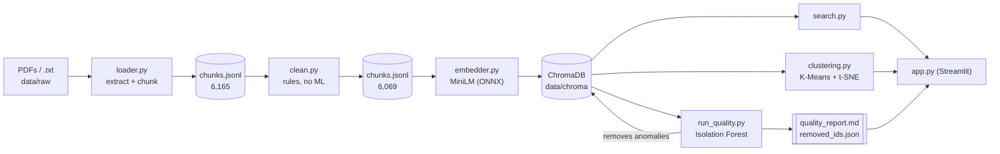
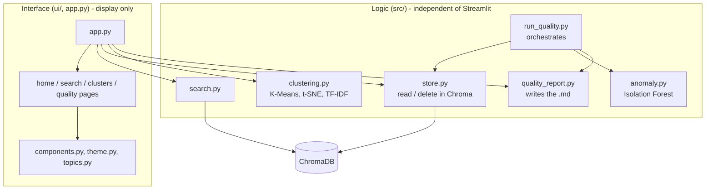
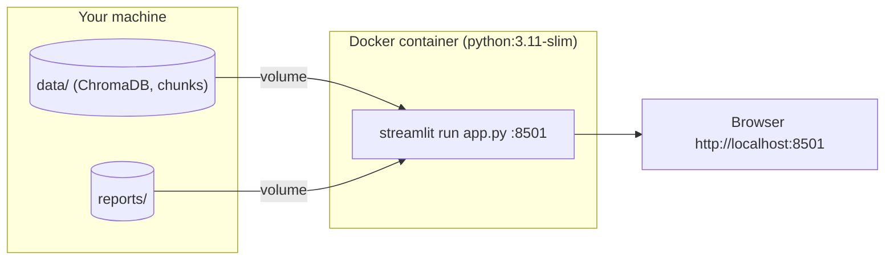

# Final Project Report

**Semantic Search, Quality Control, and Cluster Exploration over Scientific Articles**  
Author: Grazielle Nascimento Ferreira — Data Science Capstone, 2026

## 1. Summary

This project is an interactive application for exploring a corpus of 30 open-access scientific articles about the **effects of screen use on children and adolescents**, using embeddings and clustering.

- **Ingestion:** PDF files (and plain-text `.txt` files) are read, split into 250-character chunks, and cleaned using simple rules.
- **Knowledge base:** each chunk is converted into a 384-dimensional embedding and stored, together with its metadata, in a persistent ChromaDB collection.
- **Exploration:** a Streamlit interface provides semantic search, an interactive K-Means / t-SNE cluster map, and the quality report.
- **Quality control:** an Isolation Forest, run over all embeddings after the database is loaded, identifies anomalous chunks. A script generates a Markdown report (before and after cleaning) and removes the flagged chunks.

| Stage | Chunks |
|---|---:|
| Extracted from the 30 PDFs (`loader.py`) | 6,165 |
| After rule-based cleaning (`clean.py`) | 6,069 |
| Indexed in ChromaDB (`embedder.py`) | 6,069 |
| After Isolation Forest cleaning (`run_quality.py`) | **5,886** |

## 2. Domain and data

- **Domain:** screen use by children and adolescents (mental health, obesity, sleep, cognitive development, behavior and socialization, and interventions).
- **Data:** 30 articles from **PubMed Central** (open access, generally under a CC-BY license), collected in 2026. The file names are their PMC identifiers.
- **Why this domain:** it is a familiar topic with open, reusable documents and well-defined subtopics, making clusters and search results easier to interpret.

## 3. Architecture

### 3.1 Data flow



### 3.2 Modules and responsibilities



The pages receive data and functions as arguments; business logic lives in `src/` and can run without the interface (`run_quality.py` is a command-line script).

### 3.3 Deployment



`docker compose up --build` builds the image and starts the interface. The database and reports are mounted as volumes, so the container does not rebuild the index; without `data/chroma/`, the page displays "Index not found".

## 4. Design decisions

| Decision | Rationale |
|---|---|
| **ChromaDB** | Lightweight, local, and persistent; it stores metadata and distributes the embedding model. A heavier database was not needed. |
| **all-MiniLM-L6-v2 via ONNX** | Good quality for its size and does not require PyTorch (the PyTorch DLL was blocked by Windows application control). A larger model was not necessary. |
| **Cosine distance** | Measures direction (meaning), not text length. The interface shows both distance and similarity (1 − distance). |
| **250-character chunks, with 50-character overlap** | Small enough for the model's input limit; overlap avoids cutting an idea at a chunk boundary. |
| **Rule-based cleaning first** | Empty, short, numeric, or corrupted chunks are removed using simple string and regular-expression rules (96 chunks), so the model-based step only needs to assess the remainder. |
| **Isolation Forest after loading the database** | Anomaly is relative to the full set, so all embeddings are evaluated at once. Running it after loading the database also provides actual "before" and "after" data for the report. |
| **`contamination = 0.03`, 200 trees, seed 42** | A simple, explicit, reproducible threshold (the 3% with the lowest scores). The report includes examples for review. |
| **Report generated by a script** | `quality_report.md` is generated from the detection results, never manually; removed IDs are saved first (`removed_ids.json`) for auditing. |
| **K-Means** | Simple and sufficient for this corpus; the user chooses N. |
| **t-SNE (rather than PCA) for the map** | Keeps neighbors close when reducing many dimensions to two, making groups easier to see. The projection is for visualization only; clusters are computed from the original embeddings. The projection is cached on disk because the calculation is slow. |
| **TF-IDF per cluster** | Produces a readable description of each cluster (characteristic terms and main PDFs). |
| **Streamlit** | Enables quick development using Python only and provides interactive Plotly charts. |
| **No relevance labels (High/Medium/Low)** | Short queries may have larger distances even when results are correct; a label could confuse more than help. Results show objective values only. |
| **Business logic separated from the interface** | Pages receive data and functions as arguments; the logic can be tested without Streamlit. |
| **`unittest`, Docker, and simple CI** | Tests use the standard library and synthetic data (no network or real database); a CI job runs the same command; Docker provides a one-command startup. |

## 5. Results

### 5.1 Semantic search

`test_search.py` compares an in-domain query with an out-of-domain query (5 results each, using the real database):

| Query | Average cosine distance |
|---|---:|
| "screen time and obesity" | **0.17** |
| "recipe for chocolate cake" | **0.78** |

In the demo (`demo.py`), these are the distances for the 5 results:

| Query | Distances | Similarity |
|---|---|---|
| "is screen time associated with childhood obesity?" | 0.1167 – 0.1724 | 83% – 88% |
| "what is the recommended screen time limit for children?" | 0.2149 – 0.2551 | 74% – 79% |
| "what are the best recipes for chocolate cake?" (control) | 0.7166 – 0.7733 | 23% – 28% |

The index clearly distinguishes in-domain from out-of-domain queries. A single-word query such as "depression" returns relevant passages with larger distances (best result: 0.4694, 53% similarity); therefore, distances should be compared within the same query.

### 5.2 Quality control (Isolation Forest)

- 6,069 chunks were analysed; **183 (3.02%) were flagged and removed**; **5,886** remain.
- Score statistics before cleaning (min / median / max): −0.4941 / −0.4372 / −0.4022. After cleaning: −0.4630 / −0.4368 / −0.4022 (original scores for the remaining chunks, not recalculated).
- PDFs with the most flagged chunks: `PMC13540691` (18), `PMC13590006` (15), `PMC13591200` (15), `PMC13532691` (14).
- **What was found:** among the 15 most anomalous chunks there is genuine noise (lists of countries, a LaTeX preamble, a list of TV characters, and table remnants), but also legitimate methodology text. The threshold is set by `contamination`, so not every flagged chunk is junk. For this reason, the report includes a curation note and a table of examples.

The full report is in [`reports/quality_report.md`](../reports/quality_report.md).

### 5.3 Clusters

K-Means applied to the 5,886 embeddings, with N = 3:

| Cluster | Chunks | Characteristic terms | Interpretation |
|---|---:|---|---|
| 0 | 2,559 | study, children, data, intervention, health, family, school | study design and general context |
| 1 | 1,822 | screen, use, time, content, exposure, digital, television | screen use and media content |
| 2 | 1,505 | sleep, obesity, time, activity, physical, screen, bmi | health-related outcomes |

The interpretations are our reading of the terms. The groups overlap on the t-SNE map because the topics share vocabulary; K-Means always returns N groups, so the result is a guide, not a strict boundary. The interface lets users change N (from 2 to 10) and export the current chart as HTML (`reports/figures/`), providing a backup for presentations.

### 5.4 Engineering checks

- **Tests:** 32 automated tests cover the loader, storage, anomaly detection, report, quality script, clustering, search records, and interface (Streamlit's `AppTest`). They use synthetic data and an in-memory ChromaDB.
- **Existing scripts:** `loader.py` produces the same `chunks.jsonl` as before `.txt` support was added; `search.py`, `demo.py`, and `test_search.py` continue to work.
- **Docker:** the image builds, the container starts, the health-check endpoint responds, and the interface reads the database through the volume. Without `data/chroma/`, the page displays "Index not found".
- **CI:** `.gitlab-ci.yml` runs the tests in a `python:3.11-slim` job. The file was validated as YAML, but the pipeline has not yet been run on GitLab.

## 6. Limitations and future work

- **Supervised quality classifier (not implemented).** Label about 20% of flagged chunks as relevant or irrelevant, train a logistic regression on their embeddings, and use it to decide which chunks to remove instead of removing every flagged chunk.
- **Threshold selection.** Set the Isolation Forest threshold by inspecting the score distribution and a labeled sample, rather than relying only on `contamination`.
- **Stronger embeddings.** Compare all-MiniLM-L6-v2 with a larger model and measure the effect on retrieval.
- **Retrieval evaluation.** Build a small set of questions with known relevant passages to measure precision, going beyond the in-domain versus out-of-domain distance test.
- **Choosing N.** Complement the slider with a metric (for example, silhouette score) to guide the choice of the number of clusters.
- **Index lifecycle.** The interface reads `removed_ids.json`; if the index is rebuilt without repeating the cleaning step, the "removed" counts become outdated. A single source of truth for index state would prevent this.
- **t-SNE projection cache:** its validity is checked only by the number of chunks, not their content.
- **Hybrid search** (keywords plus embeddings) and incremental indexing of new documents.

## 7. How to reproduce

```bash
pip install -r requirements.txt
python src/loader.py && python src/clean.py && python src/embedder.py
python src/run_quality.py --dry-run     # detect and report only; do not remove chunks
python src/run_quality.py               # remove anomalies and write the "after" section
streamlit run app.py                    # http://localhost:8501
python -m unittest discover -s tests -t . -v
docker compose up --build               # alternative: run the interface in Docker
```

`run_quality.py` modifies the database; run it once per index (rebuild with `embedder.py` to start over). More details are in the [README](../README.md).
