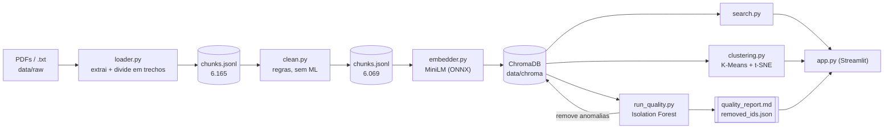
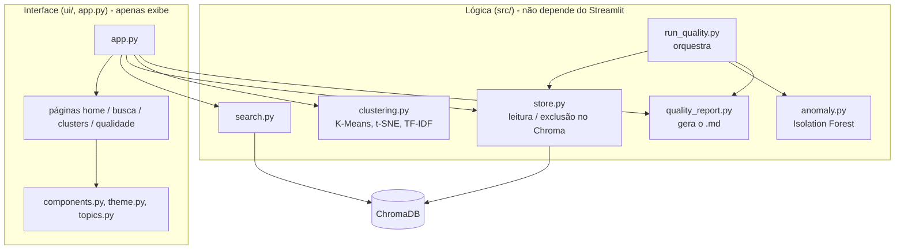
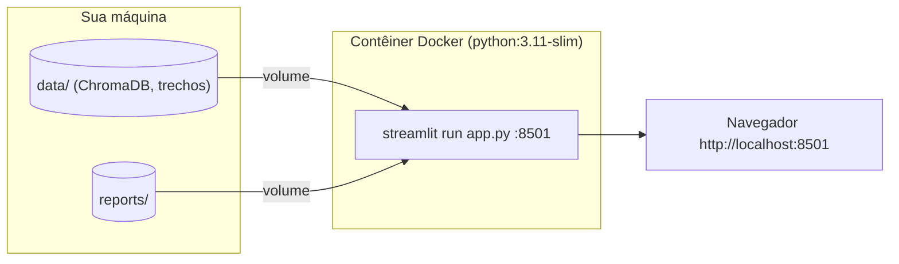

# Relatório final do projeto

**Busca semântica, controle de qualidade e exploração de clusters em artigos científicos**
Autora: Grazielle Nascimento Ferreira - Capstone de Data Science, 2026

## 1. Resumo

O projeto é uma aplicação interativa para explorar um corpus de 30 artigos científicos de acesso aberto sobre os **efeitos do uso de telas em crianças e adolescentes**, usando embeddings e clusterização.

- **Ingestão:** arquivos PDF (e arquivos de texto simples `.txt`) são lidos, divididos em trechos de 250 caracteres e limpos com regras simples.
- **Base de conhecimento:** cada trecho é convertido em um embedding de 384 dimensões e armazenado, junto com seus metadados, em uma coleção persistente do ChromaDB.
- **Exploração:** uma interface Streamlit oferece busca semântica, um mapa interativo de clusters K-Means / t-SNE e o relatório de qualidade.
- **Controle de qualidade:** um Isolation Forest, executado sobre todos os embeddings depois que o banco é carregado, identifica trechos anômalos. Um script gera um relatório Markdown (antes e depois da limpeza) e remove os trechos sinalizados.

| Etapa | Trechos |
|---|---:|
| Extraídos dos 30 PDFs (`loader.py`) | 6.165 |
| Após a limpeza baseada em regras (`clean.py`) | 6.069 |
| Indexados no ChromaDB (`embedder.py`) | 6.069 |
| Após a limpeza pelo Isolation Forest (`run_quality.py`) | **5.886** |

## 2. Domínio e dados

- **Domínio:** uso de telas por crianças e adolescentes (saúde mental, obesidade, sono, desenvolvimento cognitivo, comportamento e socialização, intervenções).
- **Dados:** 30 artigos do **PubMed Central** (acesso aberto, geralmente sob licença CC-BY), coletados em 2026. Os nomes dos arquivos são os identificadores PMC.
- **Por que esse domínio:** é um tema conhecido, com documentos abertos e reutilizáveis e subtemas bem definidos, o que facilita a interpretação dos clusters e das buscas.

## 3. Arquitetura

### 3.1 Fluxo dos dados



### 3.2 Módulos e responsabilidades



As páginas recebem dados e funções como argumentos; a lógica de negócio fica em `src/` e pode ser executada sem a interface (`run_quality.py` é um script de linha de comando).

### 3.3 Implantação



O comando `docker compose up --build` cria a imagem e inicia a interface. O banco de dados e os relatórios são montados como volumes, portanto o contêiner não recria o índice; sem `data/chroma/`, a página exibe "Index not found".

## 4. Decisões de projeto

| Decisão | Justificativa |
|---|---|
| **ChromaDB** | Leve, local e persistente; armazena metadados e distribui o modelo de embeddings. Não havia necessidade de um banco mais pesado. |
| **all-MiniLM-L6-v2 via ONNX** | Boa qualidade para o seu tamanho e não exige PyTorch (a DLL do PyTorch foi bloqueada pelo controle de aplicativos do Windows). Um modelo maior não era necessário. |
| **Distância de cosseno** | Mede a direção (significado), não o comprimento do texto. A interface mostra a distância e a similaridade (1 − distância). |
| **Trechos de 250 caracteres, com sobreposição de 50** | São pequenos o suficiente para o limite de entrada do modelo; a sobreposição evita cortar uma ideia na fronteira entre trechos. |
| **Limpeza baseada em regras primeiro** | Trechos vazios, curtos, numéricos ou corrompidos são removidos com regras simples de texto/expressões regulares (96 trechos), para que a etapa baseada em modelo analise apenas o restante. |
| **Isolation Forest após carregar o banco** | A anomalia é relativa ao conjunto completo, então todos os embeddings são avaliados de uma vez. Executá-lo depois de carregar o banco também permite gerar dados reais de "antes" e "depois" para o relatório. |
| **`contamination = 0.03`, 200 árvores, semente 42** | Um limite simples, explícito e reproduzível (os 3% com menores pontuações). O relatório apresenta exemplos para revisão. |
| **Relatório gerado por script** | `quality_report.md` é produzido a partir do resultado da detecção, nunca manualmente; os IDs removidos são salvos antes (`removed_ids.json`) para auditoria. |
| **K-Means** | Simples e suficiente para este corpus; o usuário escolhe N. |
| **t-SNE (em vez de PCA) para o mapa** | Mantém vizinhos próximos ao reduzir muitas dimensões para duas, facilitando a visualização dos grupos. A projeção serve apenas para exibição; os clusters são calculados sobre os embeddings originais. Como o cálculo é demorado, a projeção fica em cache no disco. |
| **TF-IDF por cluster** | Produz uma descrição legível de cada cluster (termos característicos e principais PDFs). |
| **Streamlit** | Permite desenvolver rapidamente usando apenas Python e oferece gráficos interativos com Plotly. |
| **Sem rótulos de relevância (Alta/Média/Baixa)** | Consultas curtas podem ter distâncias maiores mesmo quando os resultados estão corretos; um rótulo poderia confundir mais do que ajudar. Os resultados exibem apenas valores objetivos. |
| **Lógica de negócio separada da interface** | As páginas recebem dados e funções como argumentos; a lógica pode ser testada sem o Streamlit. |
| **`unittest`, Docker e CI simples** | Os testes usam a biblioteca padrão e dados sintéticos (sem rede nem banco real); uma tarefa de CI executa o mesmo comando; o Docker permite iniciar a aplicação com um único comando. |

## 5. Resultados

### 5.1 Busca semântica

`test_search.py` compara uma consulta dentro do domínio com outra fora do domínio (5 resultados para cada uma, usando o banco real):

| Consulta | Distância média de cosseno |
|---|---:|
| "screen time and obesity" | **0.17** |
| "recipe for chocolate cake" | **0.78** |

Na demonstração (`demo.py`), estas são as distâncias dos 5 resultados:

| Consulta | Distâncias | Similaridade |
|---|---|---|
| "is screen time associated with childhood obesity?" | 0.1167 – 0.1724 | 83% – 88% |
| "what is the recommended screen time limit for children?" | 0.2149 – 0.2551 | 74% – 79% |
| "what are the best recipes for chocolate cake?" (controle) | 0.7166 – 0.7733 | 23% – 28% |

O índice diferencia claramente as consultas dentro e fora do domínio. Uma consulta de uma única palavra, como "depression", retorna passagens corretas com distâncias maiores (melhor resultado: 0.4694, similaridade de 53%); portanto, as distâncias devem ser comparadas dentro da mesma consulta.

### 5.2 Controle de qualidade (Isolation Forest)

- Foram analisados 6.069 trechos; **183 (3,02%) foram sinalizados e removidos**; restaram **5.886**.
- Estatísticas das pontuações antes da limpeza (mín. / mediana / máx.): −0.4941 / −0.4372 / −0.4022. Depois: −0.4630 / −0.4368 / −0.4022 (pontuações originais dos trechos restantes, não recalculadas).
- PDFs com mais trechos sinalizados: `PMC13540691` (18), `PMC13590006` (15), `PMC13591200` (15), `PMC13532691` (14).
- **O que foi encontrado:** entre os 15 trechos mais anômalos há ruído real (listas de países, um preâmbulo LaTeX, uma lista de personagens de TV e resíduos de tabelas), mas também texto legítimo de metodologia. O limite é definido por `contamination`, portanto nem todo trecho sinalizado é lixo. Por isso, o relatório inclui uma observação de curadoria e uma tabela de exemplos.

O relatório completo está em [`reports/quality_report.md`](../reports/quality_report.md).

### 5.3 Clusters

K-Means aplicado aos 5.886 embeddings, com N = 3:

| Cluster | Trechos | Termos característicos | Interpretação |
|---|---:|---|---|
| 0 | 2.559 | study, children, data, intervention, health, family, school | desenho dos estudos e contexto geral |
| 1 | 1.822 | screen, use, time, content, exposure, digital, television | uso de telas e conteúdo de mídia |
| 2 | 1.505 | sleep, obesity, time, activity, physical, screen, bmi | resultados relacionados à saúde |

As interpretações são leituras nossas dos termos. Os grupos se sobrepõem no mapa t-SNE porque os temas compartilham vocabulário; o K-Means sempre retorna N grupos, então o resultado é uma orientação, não uma divisão rígida. A interface permite alterar N (de 2 a 10) e exportar o gráfico atual como HTML (`reports/figures/`), servindo como cópia de segurança para apresentações.

### 5.4 Verificações de engenharia

- **Testes:** 32 testes automatizados cobrem o carregador, o armazenamento, a detecção de anomalias, o relatório, o script de qualidade, a clusterização, os registros de busca e a interface (`AppTest` do Streamlit). Eles usam dados sintéticos e um ChromaDB em memória.
- **Scripts existentes:** `loader.py` produz o mesmo `chunks.jsonl` de antes da inclusão do suporte a `.txt`; `search.py`, `demo.py` e `test_search.py` continuam funcionando.
- **Docker:** a imagem é criada, o contêiner inicia, o endpoint de verificação de saúde responde e a interface acessa o banco pelo volume. Sem `data/chroma/`, a página exibe "Index not found".
- **CI:** `.gitlab-ci.yml` executa os testes em uma tarefa `python:3.11-slim`. O arquivo foi validado como YAML, mas o pipeline ainda não foi executado no GitLab.

## 6. Limitações e trabalhos futuros

- **Classificador supervisionado de qualidade (não implementado).** Rotular como relevantes ou irrelevantes cerca de 20% dos trechos sinalizados, treinar uma regressão logística sobre seus embeddings e usá-la para decidir quais trechos remover, em vez de remover todos os sinalizados.
- **Escolha do limite.** Definir o limiar do Isolation Forest inspecionando a distribuição das pontuações e uma amostra rotulada, em vez de depender apenas de `contamination`.
- **Embeddings mais robustos.** Comparar o all-MiniLM-L6-v2 com um modelo maior e medir o efeito na recuperação.
- **Avaliação da recuperação.** Criar um pequeno conjunto de perguntas com passagens relevantes conhecidas para medir a precisão, indo além do teste de distância entre consultas dentro e fora do domínio.
- **Escolha de N.** Complementar o controle deslizante com uma métrica (por exemplo, silhouette) para apoiar a escolha do número de clusters.
- **Ciclo de vida do índice.** A interface lê `removed_ids.json`; se o índice for recriado sem repetir a limpeza, os números de trechos "removidos" ficam desatualizados. Uma fonte única de verdade para o estado do índice evitaria isso.
- **Cache da projeção t-SNE:** sua validade é conferida apenas pelo número de trechos, não pelo conteúdo.
- **Busca híbrida** (palavras-chave e embeddings) e indexação incremental de novos documentos.

## 7. Como reproduzir

```bash
pip install -r requirements.txt
python src/loader.py && python src/clean.py && python src/embedder.py
python src/run_quality.py --dry-run     # detecta e gera o relatório, sem remover trechos
python src/run_quality.py               # remove anomalias e escreve a seção "depois"
streamlit run app.py                    # http://localhost:8501
python -m unittest discover -s tests -t . -v
docker compose up --build               # alternativa: executar a interface no Docker
```

`run_quality.py` altera o banco de dados; execute-o uma vez por índice (para começar de novo, recrie o índice com `embedder.py`). Mais detalhes estão no [README](../README.md).
